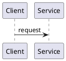

# Smalum

> Русская версия: [README.ru.md](./README.ru.md)

**Diagram-as-code preview** — PlantUML, Mermaid, BPMN, DFD, Infra, IDEF, Struct, SQL→ER — right in markdown.

## The problem

You write the diagram as text: fast, in git, next to the code. Auto-layout ruins the picture. You fix the layout by hand — then change one source line — and the layout is gone.

A visual editor keeps the layout but kills “diagram as code”: the file stops being the source of truth.

## The solution

Smalum: **text = structure**, **mouse = layout**. Layout is written back into the same file as an `SM:` overlay (coordinates in comments). The next parse takes structure from the code and the picture from the overlay.

This plugin is a **read-only preview** of the same parse and the same overlay as the editor. Drop a source fence into a note — the diagram renders with your layout. Any supported notation from code, not “one external image”.



In Obsidian notes use the `sm` / `smalum` fence (Smalum source). Render needs no network to `*.smalum.io`.

## Does / does not

| Does | Does not (on purpose) |
|------|------------------------|
| Parse PlantUML, Mermaid, DFD, BPMN, Struct, Infra, SQL→ER | Edit the canvas with the mouse |
| Render with `SM:` / `%% SM:` overlay | Cloud, sharing, BPMN token simulator |
| Preview in markdown / `.sm` with no network to `*.smalum.io` | Write overlay from the preview |

Full canvas, cloud, and guest editor live on [app.smalum.io](https://app.smalum.io). The plugin and the site speak the same language and the same overlay.

## Notations

| Notation | Input |
|----------|-------|
| BPMN | `//smalum/bpmn` |
| DFD | `//smalum/dfd` |
| Struct | `//smalum/struct`, `struct/staff` |
| Infra | `//smalum/infra`, `infra/flow`, `infra/l2`, `infra/l3` |
| PlantUML | `@startuml` |
| Mermaid | `flowchart`, `sequenceDiagram`, … + `%% SM:` |
| SQL→ER | `CREATE TABLE` |

## Install via BRAT

URL: `https://github.com/smalum/obsidian`

If BRAT reports **GitHub API rate limit exceeded**, that is the anonymous GitHub API limit (~60/hour), not a plugin bug. Wait for the reset **or** paste a classic PAT with `public_repo` into Settings → BRAT (or the token field in the Add plugin dialog).

The release tag must match `version` in `manifest.json` (no `v` prefix). Preview without white paper: note background, tokens as in VS Code. C4 fills (person / container / ext) are **not** inverted with the theme.

## Install (manual)

Build from the monorepo root:

```bash
npm run build:obsidian
```

Copy into the vault:

`.obsidian/plugins/smalum/main.js`  
`.obsidian/plugins/smalum/manifest.json`  
`.obsidian/plugins/smalum/styles.css`

Enable **Smalum** under Community plugins. In a note:

````markdown
```sm
//smalum/dfd Example
user - order Place order
```
````

Offline render. “Open in Smalum” does not put the source into the URL.

## Links

- Site: [smalum.io](https://smalum.io)
- Editor: [app.smalum.io](https://app.smalum.io)
- Docs: [docs.smalum.io](https://docs.smalum.io)
- LLM role file: [docs.smalum.io/role.md](https://docs.smalum.io/role.md)

**Small language. Sharp diagrams.**
