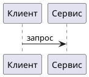

# Smalum

**Превью диаграмм как код** — PlantUML, Mermaid, BPMN, DFD, Struct, Infra, SQL→ER — прямо в markdown.

## Боль

Схему пишут текстом: быстро, в git, рядом с кодом. Картинку автолейаут портит. Довели вид вручную — поправили строку исходника — раскладка сгорела.

Визуальный редактор сохраняет вид, но убивает «схему как код»: файл перестаёт быть источником правды.

## Решение

Smalum: **текст = состав**, **мышь = вид**. Вид пишется обратно в тот же файл оверлеем `SM:` (координаты в комментариях). Следующий разбор берёт состав из кода, картинку — из оверлея.

Этот плагин — **read-only превью** того же разбора и того же оверлея, что в редакторе. Вставили блок исходника в `.md` — схема рисуется с вашей раскладкой. Любая поддерживаемая нотация из кода, не «одна картинка снаружи».



В заметках Obsidian — fence `sm` / `smalum` (исходник Smalum). Рендер без сети к `*.smalum.io`.

## Умеет / не умеет

| Умеет | Не умеет (намеренно) |
|-------|----------------------|
| Разбор PlantUML, Mermaid, DFD, BPMN, Struct, Infra, SQL→ER | Редактирование холста мышью |
| Отрисовка с оверлеем `SM:` / `%% SM:` | Облако, шаринг, симулятор BPMN |
| Превью в markdown / `.sm` без сети к `*.smalum.io` | Запись оверлея из превью |

Полноценный холст, облако и гостевой редактор — на [app.smalum.io](https://app.smalum.io). Плагин и сайт говорят на одном языке и одном оверлее.

## Нотации

| Нотация | Вход |
|---------|------|
| BPMN | `//smalum/bpmn` |
| DFD | `//smalum/dfd` |
| Struct | `//smalum/struct`, `struct/staff` |
| Infra | `//smalum/infra`, `infra/flow`, `infra/l2`, `infra/l3` |
| PlantUML | `@startuml` |
| Mermaid | `flowchart`, `sequenceDiagram`, … + `%% SM:` |
| SQL→ER | `CREATE TABLE` |

## Установка через BRAT

URL: `https://github.com/smalum/obsidian`

Если BRAT пишет **GitHub API rate limit exceeded** — это лимит анонимного GitHub API (~60/час), не ошибка плагина. Подождите сброса **или** вставьте classic PAT со scope `public_repo` в Settings → BRAT (или в поле токена диалога Add plugin).

Тег релиза должен совпадать с `version` в `manifest.json` (без префикса `v`). Превью без белой бумаги: фон заметки, токены как в VS Code. C4-заливки (person / container / ext) **не** инвертируются с темой.

## Установка (ручная)

Собрать из корня монорепо:

```bash
npm run build:obsidian
```

Скопировать в vault:

`.obsidian/plugins/smalum/main.js`  
`.obsidian/plugins/smalum/manifest.json`  
`.obsidian/plugins/smalum/styles.css`

Включить **Smalum** в Community plugins. В заметке:

````markdown
```sm
//smalum/dfd Пример
user - order Оформить
```
````

Рендер без сети. «Открыть в Smalum» не кладёт исходник в URL.

## Ссылки

- Сайт: [smalum.io](https://smalum.io)
- Редактор: [app.smalum.io](https://app.smalum.io)
- Документация: [docs.smalum.io](https://docs.smalum.io)
- Файл роли для LLM: [docs.smalum.io/role.md](https://docs.smalum.io/role.md)

**Small language. Sharp diagrams.**
